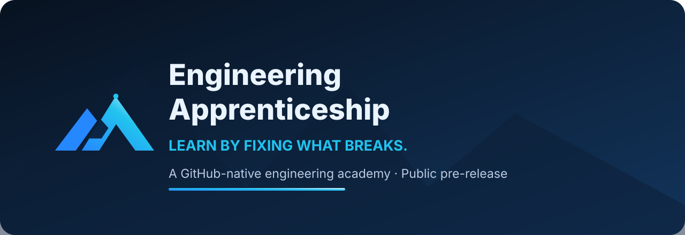

# Engineering Apprenticeship branding

> **Working identity · public pre-release** — brand design does not imply launch readiness.

**Learn by fixing what breaks.**

The Academy's official working brand materials live here:

- [Brand strategy, messaging and usage](BRAND_GUIDE.md)
- [Square SVG brand mark](assets/ea-mark.svg)
- [Wide GitHub README banner](assets/ea-banner.svg)

The academy is founder-led and GitHub-native: realistic engineering incidents, Issue → branch → PR → Actions → review, and a connected Data + Cloud capstone.

**Marketing status:** share the vision and demonstrated development progress, but do not advertise enrollment, verified learning outcomes, certifications, or a completed v1. For release readiness see [PUBLIC_LAUNCH.md](../docs/PUBLIC_LAUNCH.md).

The name and logo remain **draft brand assets** until founder approval and necessary legal/availability checks.
